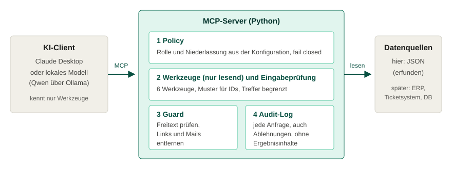

# facility-mcp-demo

Ein MCP-Server, der fiktive interne Systeme eines Gebäudedienstleisters (Objekte, Reinigungspläne, Reklamationen, Material) für KI-Assistenten öffnet. Lesend, nach Rolle begrenzt, mit Protokoll jeder Anfrage.

Das ist ein Praxisbeispiel zur Frage: **Wie bindet man interne Systeme an ein Sprachmodell an, ohne dem Modell mehr zuzutrauen, als man verantworten kann?** Alle Daten sind erfunden. Es gibt keine Personendaten.



**Ansehen ohne Installation:** [rroessger.github.io/facility-mcp-demo](https://rroessger.github.io/facility-mcp-demo/) zeigt aufgezeichnete Antworten des echten Servers (Quelle: `docs/index.html`).

## Was der Server tut

| Baustein | Umsetzung | Datei |
|---|---|---|
| Nur lesen | 6 Werkzeuge, alle mit `read_only_hint`, keines schreibt, löscht oder versendet | `server.py` |
| Rollen | Vier Rollen mit festen Rechten. Rolle und Niederlassung kommen aus der Server-Konfiguration, das Modell kann sie nicht ändern | `policy.py` |
| Fail closed | Unbekannte Rolle oder fehlende Niederlassung: Server startet nicht. Fremde Niederlassung: Anfrage wird abgelehnt, nicht still umgeleitet | `policy.py`, `server.py` |
| Eingabeprüfung | IDs nur im erlaubten Muster (`O-1002`), Auswahlfelder als feste Liste, Trefferzahl begrenzt | `server.py` |
| Freitext als Fremddaten | Reklamationstexte werden normalisiert, Mail-Adressen und Links entfernt, Texte mit Anweisungsmustern nicht ausgeliefert, Rest als "Daten, keine Anweisung" gekennzeichnet | `guard.py` |
| Nachvollziehbarkeit | Audit-Log als JSON Lines: Zeit, Rolle, Werkzeug, Parameter, Entscheidung, Grund. Keine Ergebnisinhalte | `audit.py` |

Rollen im Überblick:

| Rolle | Werkzeuge | Niederlassungen |
|---|---|---|
| `objektleiter` | Objekte, Reinigungsplan, Reklamationen (Liste) | eigene |
| `qualitaetssicherung` | dazu Reklamation im Detail, Kennzahlen | eigene |
| `einkauf` | Materialbestand | eigene |
| `leitung` | alle | alle |

## Schnellstart

Voraussetzung: Python 3.11 oder neuer.

```bash
git clone https://github.com/rroessger/facility-mcp-demo.git
cd facility-mcp-demo
python -m venv .venv
source .venv/bin/activate        # Windows: .venv\Scripts\activate
pip install -e ".[dev]"
pytest -q                        # 32 Tests
```

Server mit einer Rolle starten (stdio):

```bash
FACILITY_ROLE=qualitaetssicherung FACILITY_BRANCH=Chemnitz facility-mcp
```

### Mit Claude Desktop

`claude_desktop_config.example.json` in die Konfiguration von Claude Desktop übernehmen, Pfad anpassen, Claude neu starten. Danach zum Beispiel fragen: "Welche Reklamationen sind in Chemnitz offen?" und "Was steht in R-2026-0901?".

### Mit einem lokalen Modell (Qwen über Ollama)

```bash
ollama pull qwen2.5:7b           # Modellnamen und Größen vorher bei ollama.com prüfen
python clients/ollama_chat.py --model qwen2.5:7b --role qualitaetssicherung --branch Chemnitz
```

## Teststand (ehrlich)

| Was | Stand |
|---|---|
| Server, Rollen, Guard, Audit-Log | 32 automatische Tests, laufen in CI (`.github/workflows/ci.yml`) |
| Echter Start als Prozess über stdio | getestet |
| Tests prüfen wirklich etwas | Gegenprobe gemacht: Schutz abgeschaltet, 9 Tests werden rot |
| Claude Desktop | noch nicht getestet |
| Lokales Modell über Ollama (`clients/ollama_chat.py`) | Kurztest mit `qwen2.5:7b`, vier Fragen, je einmal. Werkzeug und Parameter waren bei drei von vier Fragen korrekt, der gesperrte Freitext wurde nicht ausgeliefert, die Rollenänderung per Chat blieb wirkungslos. Ein Befund: Bei der Frage nach Zwickau erfand das Modell einen Parameter, den das Werkzeug nicht hatte, der Server ignorierte ihn und lieferte Chemnitzer Daten, die das Modell als Zwickau beschriftete. Kein Datenabfluss, aber eine falsche Antwort. Behoben: Das Werkzeug hat jetzt den Parameter `niederlassung` mit derselben Prüfung wie die anderen, jede Zeile nennt ihre Niederlassung, zwei neue Tests. Das ist ein Einzeltest und keine Auswertung der Zuverlässigkeit. Eine Testreihe mit Trefferquote steht aus |

## Grenzen

- **Die Injection-Erkennung ist keine vollständige Abwehr.** Mustererkennung lässt sich umgehen. Der eigentliche Schutz ist die Architektur: nur lesende Werkzeuge, enge Rollen, Niederlassungsgrenzen und kein Werkzeug, das Daten versenden kann. Der Guard ist eine zusätzliche Schicht.
- **Identität per Umgebungsvariable** ist für eine Demo mit stdio in Ordnung. Im Betrieb gehört eine echte Anmeldung davor (OAuth, z. B. über das Identitätssystem des Unternehmens) und ein Server über Streamable HTTP. Das SDK bringt dafür Bausteine mit.
- **Daten sind eine JSON-Datei.** In der Praxis liest `data.py` aus Datenbank oder Fachsystem, mit eigenem technischen Benutzer mit minimalen Rechten.
- **Kein Ersatz für Datenschutzprüfung.** Siehe `docs/DESIGN.md`, Abschnitt DSGVO und EU-KI-Verordnung.

## Nächste Schritte

1. Streamable HTTP und OAuth statt Umgebungsvariablen
2. `docker compose`-Stack: Ollama mit Qwen, Open WebUI und dieser Server
3. Auswertung: Testfragen, Trefferquote beim Werkzeugaufruf je Modell, dazu Ablehnung unbekannter Parameter (Fund aus dem Qwen-Kurztest)
4. Echte Datenquelle (z. B. Ticketsystem) hinter `data.py`

## Projektstruktur

```
src/facility_mcp/   server, policy, guard, audit, data
data/               synthetische Daten (scripts/generate_data.py)
tests/              32 Tests
clients/            Beispiel-Client für Ollama
docs/               index.html (Aufzeichnung), architektur.svg, DESIGN.md
scripts/            Datengenerator, Aufzeichnung für docs/index.html
```

## GitHub Pages

Repository-Einstellungen, Pages, Quelle: Branch `main`, Ordner `/docs`. Die Seite zeigt die mit `scripts/record_demo.py` aufgezeichneten Server-Antworten.

## Lizenz

MIT, siehe `LICENSE`.
